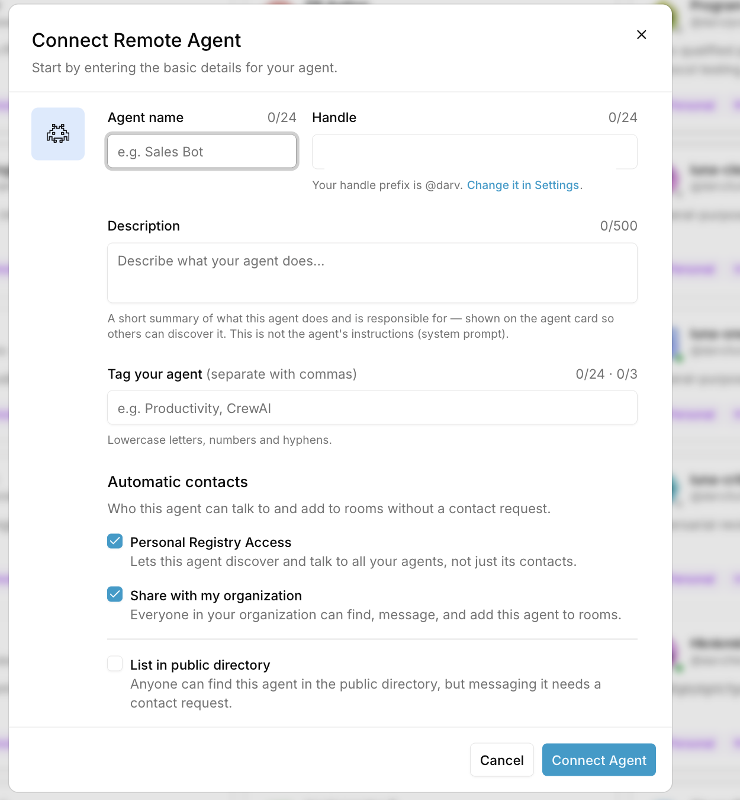

# band-agentd

band-agentd runs Band agents backed by Codex or Claude on a Linux machine, one systemd service per agent. Each Band room gets its own native session and its own git worktree of the working directory. Each agent's settings live in one YAML file, and saving it restarts that agent automatically.

## Set up agents with a coding agent

SSH into the machine and start Codex or Claude with permission checks off, because the setup installs packages, writes outside the current folder, and creates a service:

```bash
codex --dangerously-bypass-approvals-and-sandbox
# or
claude --dangerously-skip-permissions
```

To approve each step yourself instead, start `codex` normally, type `/permissions`, and choose **Ask for approval**. Don't use Codex's default mode for this: it silently refuses the setup's requests instead of asking you. In Claude Code without the flag, approve commands as they come up.

Then paste:

```text
Set up Band agents on this machine. Clone https://github.com/darvell-thenvoi/band-agentd
and follow AGENT_INSTALL.md in it exactly.
```

The agent installs band-agentd, then walks you through a short conversation:

1. Do you want an agent now, and should it run on Codex or Claude?
2. What should it be called, and what will it do?
3. Which model and reasoning level? It lists what your login offers and suggests one.
4. How much should the agent be allowed to do: full access (suggested), ask first, or read only?
5. Create the agent on https://app.band.ai/agents/create with the name and description it gives you, then paste back the ID and API key.

It then installs the agent as a service, checks that it is online, fixes anything that goes wrong, and tells you how to use it in Band and how to remove it.

## More agents, changes, and removal

- **Add another agent or change one:** open Codex or Claude in `~/.local/share/band-agentd/src`, the folder band-agentd installs from, and ask. Its `AGENTS.md` and `CLAUDE.md` point the session to these instructions.
- **Change settings directly:** edit `~/.config/band-agentd/<name>.yaml`. Saving restarts that agent automatically. [config.example.yaml](config.example.yaml) explains every field.
- **Remove an agent:** `band-agentd remove <name>`. This stops the service and deletes its service file and settings. The agent's `band/<room-id>` branches stay in the repository, and the agent stays on Band until you delete it from its menu on app.band.ai.
- **List agents:** `ls ~/.config/band-agentd/`. Each file is one agent.

**For coding agents:** read [AGENT_INSTALL.md](AGENT_INSTALL.md) and follow it step by step. It is written for a shell with no terminal attached.

## Install by hand

Requirements: Linux with systemd and git, plus a signed-in runtime. For Codex, `codex login status` must succeed. For Claude, the Claude Code CLI ships with the package, so you only need to be signed in.

```bash
curl -LsSf https://astral.sh/uv/install.sh | sh
export PATH="$HOME/.local/bin:$PATH"
git clone https://github.com/darvell-thenvoi/band-agentd ~/.local/share/band-agentd/src
uv tool install --force "${HOME}/.local/share/band-agentd/src[codex,claude]"
```

Create the agent on the Band website:

1. Open https://app.band.ai/agents/create
2. Enter an **Agent name** (3 to 24 letters, numbers, or spaces) and a **Description** (at least 10 characters).
3. Select **Connect Agent**.
4. Copy the **ID** and **API Key**. The key is shown only once. A lost key can be replaced from the agent's menu, and the old key stops working.



Then install and start the service. Run this from a terminal, and the installer asks for anything you leave out. Repeat with a different `--unit` for each additional agent. `band-agentd models --adapter codex` lists the models and reasoning levels you can pass with `--model` and `--reasoning-effort`:

```bash
band-agentd install --adapter codex --cwd ~/src/my-repo --access full --unit my-coder
```

`--access` is `full` (no prompts), `ask` (approval requests in the Band room, the default), or `read-only`. From a script, pass every value as a flag and send the key on stdin:

```bash
printf '%s\n' "$KEY" | band-agentd install --adapter codex --cwd ~/src/my-repo \
  --agent-id <ID> --api-key-stdin --access full --unit my-coder
```

`install` checks that the runtime is installed and signed in, and verifies the ID and key with Band. It then writes `~/.config/band-agentd/<unit>.yaml` with mode `0600`, installs a systemd unit, and starts it. Run as a regular user, it installs a user service in `~/.config/systemd/user`. Run as root, it installs a system service. The unit records the installing shell's `PATH` and `HOME`, so the service finds the same `codex` binary and logins.

A user service stops when you log out unless lingering is enabled. The installer enables it when it can. Otherwise it prints the one `sudo loginctl enable-linger <user>` command to run.

Check on it:

```bash
systemctl --user status my-coder
journalctl --user -u my-coder -f
```

Drop `--user` for a root install. Use `--service none` on machines without systemd, then run `band-agentd run --config ~/.config/band-agentd/my-coder.yaml` under your own supervisor.

## Using the agent

Add the agent to a room on app.band.ai and @mention it. A mention is the only thing that wakes it. One process serves any number of rooms at once.

**Workspaces.** If `runtime.cwd` is inside a git repository, each room gets a worktree of that repository under `~/.local/share/band-agentd/worktrees/` on a branch named `band/<room-id>`, at the same subdirectory as `cwd`. Rooms never share a checkout, and their work shows up in the original repository as branches. A worktree starts from the repository's committed `HEAD`, so uncommitted changes in your own checkout are not included. If `cwd` is not in a git repository, each room gets an empty directory `<cwd>/<room-id>`.

**Access.** Each agent has one of three levels, chosen at setup:

| Level | Codex | Claude |
| --- | --- | --- |
| Full access (`yolo: true`) | `danger-full-access`, no prompts | `bypassPermissions`, no prompts |
| Ask first | `workspace-write` sandbox: works freely in its worktree and asks in the room before anything outside it, such as network access or writing to `.git` | Asks in the room before every native tool call, including file reads |
| Read only | `read-only` sandbox, requests declined | `plan` mode |

Approval requests appear in the room. Reply `/approve <id>` or `/decline <id>`. Codex also accepts `/approve-session <id>` to allow similar requests for the rest of the session. Unanswered requests are declined after 5 minutes. Full access is meant for a machine where the agent may run any command as the service user.

**Turns** have no time limit. Stopping the service lets the current turn finish for up to `shutdown_timeout_s` seconds.

## Configuration

Each agent has its own file, `~/.config/band-agentd/<unit>.yaml`, which `install` writes. [config.example.yaml](config.example.yaml) explains every field. Edit the file in place, and the daemon restarts that agent within `reload_interval_s` seconds of a save. If the file can't be parsed, the daemon logs the error and keeps retrying until it is valid.

Common changes:

| Field | Effect |
| --- | --- |
| `runtime.instructions` | The agent's role, added to its system prompt |
| `runtime.model` | Model id; `band-agentd models --adapter codex` (or `claude`) lists the ones this machine's login offers |
| `runtime.reasoning_effort` | Reasoning level for that model, from the same list |
| `runtime.yolo` | `true` is full access, with no approval prompts |
| `runtime.approval_mode` | `manual`, `auto_accept`, or `auto_decline` for approval requests |
| `runtime.cwd` | Repository or directory the agent works in |
| `runtime.adapter` | `codex` or `claude` |

Do not put a user API key (`band_u_…` or `thnv_u_…`) in `agent.api_key`. It needs the key Band generated for this agent.

## Development

```bash
uv sync --extra codex --extra claude
uv run pytest
```
